# Claudeopticon

**See everything Claude is doing, in one live pane.**

Claudeopticon is a mod for Claude Code. It adds the Work pane next to your conversation. The pane shows your todo list as a ticket board, what Claude is doing, what its helpers (Claude Code calls them agents) are doing, and what runs in the background. You can send a ticket to Claude, ask how it is going, or move it yourself.


## Contents

- [Requirements](#requirements)
- [Install](#install)
- [Quick start](#quick-start)
- [The pane](#the-pane)
- [The todo format](#the-todo-format)
- [Rules for Claude](#rules-for-claude)
- [Agents and progress](#agents-and-progress)
- [Options](#options)
- [Cost and privacy](#cost-and-privacy)
- [Limits](#limits)
- [Development](#development)
- [License](#license)

## Requirements

- Claude Code 2.1.275 or later.
- The desktop app or VS Code for the card view. A terminal shows the same data as text.

## Install

Run this line in Claude Code:

```
/plugin install claudeopticon --marketplace Marceux-Croix/Claudeopticon
```

The pane opens at the start of each session. To open it again, run `/claudeopticon`. In a session that is already running, run `/reload-plugins` first.

## Quick start

1. Make a folder `.claude_todo/` at the root of your repo, and a file in it, for example `.claude_todo/TODO.md`:

   ```markdown
   - [ ] #T1 Write the migration for the v2 config format
   - [ ] #T2 Document the plugin API
   ```

2. Open the pane. The items show as tickets in the Open column.
3. Click `⋙` on a ticket to send it to Claude. Claude marks it `[~]`, and the ticket moves to In progress.
4. When Claude starts an agent for a ticket, the agent's card links to it and shows its progress.

## The pane

### Top card


- **Todo:** how much of your todo is done.
- **Agents:** how many agents run, and how far along they are together.
- **Tokens:** how much text Claude has processed this session (a token is the unit of Claude's usage). The line below counts since the last compaction, when Claude Code shrinks a long conversation to free up room.

### Orchestrator: what Claude is doing


This card lists what Claude does itself, not its agents. Each line is the short description Claude already writes for an action, with its start time. The newest is on top. A pulsing dot means the action still runs. **Older** and **Newer** page through the history.

### Background tasks: what runs in the background



Claude can start work that keeps running: a build, a server, a monitor (a watch on a log file), or a workflow of several agents. Each task gets a line with a short name, its start time, and a dot: pulsing while it runs, gray when it ended ("(failed)" or "(stopped)" if not clean). Haiku, Claude's small model, makes the name once, at the start. A task that a helper agent started ends with that agent.

Finished tasks are hidden. **Show finished tasks** brings them back. Agents that run in the background have their own cards.

### Agents: what Claude's helpers are doing


Each agent gets a card, labeled A1, A2, and so on, in start order. Each agent has its own color. A card shows what the agent was asked to do, its tickets, its progress ("Step 3 of 7" with a bar), its run time, tool calls and tokens, and what it does now. A timeline above the cards shows one bar per agent.

A running agent has a **Stop** button (⊖) left of its status. Stop ends the agent at once. It gets no chance to finish its step or write a summary. Use it when an agent has gone wrong.

If an agent vanishes from Claude Code's agent list without a report of how it ended, its card shows **Ended** after 15 seconds.

Finished agents are hidden. **Show finished agents** brings them back, grayed out. You can name an agent by its label in chat ("how is A2 doing?"). The mod tells Claude which agent that is.

### Todo: the ticket board


Each todo file becomes a board with the columns **In progress**, **Open** and **Done**. A ticket shows its number, its group, its status, and the tags of the agents working on it. The tags blink in the agent's color. When an agent starts on a ticket, the ticket moves to In progress by itself.

Tickets that are not done have buttons on the bottom edge:

| Button | On | What it does |
| --- | --- | --- |
| `⋙` Send to Claude | Open tickets | Sends the item to Claude as a prompt, to build it. |
| `?` Ask Claude for a status update | Tickets in progress, or already sent | Asks Claude for a short report in the chat. It starts no new work. |
| `◐` Mark in progress | Open tickets | Moves the ticket by hand. |
| `✓` Mark done | Tickets in progress | Moves the ticket by hand. |
| `↩` Move back to open | Tickets in progress | Moves the ticket by hand. |

The move buttons are for work you do yourself, such as a human review. They change the checkbox in your todo file and nothing else. Claude is told at its next action, so it does not work on a ticket you closed. It is not asked to do anything.

Other controls:

- **Show as list** shows each file as a list. **Arrange by category** groups the list.
- The **group buttons** show or hide each group. Haiku makes the groups: it reads your open tickets, names up to five groups, and puts each ticket in one. A ticket keeps its group, and new tickets are sorted as they appear.
- **Show completed** adds finished tickets and archived todo files.
- The **search box** finds tickets with every word you type.

## The todo format

The mod reads checkbox lines in the Markdown files at the top level of `.claude_todo/`, and in `.claude_todo/archive/`.

```markdown
- [ ] #T4 Open item
- [~] #T5 Item in progress
- [x] #T6 Done item
```

- Give each item a short ID, `#T<n>`, unique in the project.
- Prose, tables and headings may surround the items. Only checkbox lines count.
- When an item is done, check it off and leave it in the file. Checked items are your record of finished work.
- When every item in a file is done, move the file to `.claude_todo/archive/`.
- The folder lives at the root of the repo's main checkout. A git worktree uses the main checkout's folder.

## Rules for Claude

At the start of each conversation, the mod gives Claude short instructions. Claude:

- keeps `.claude_todo/` in the format above and updates each box as status changes;
- puts the item's ID in the description of each agent it starts for that item;
- finds or adds an item before it starts any work;
- stops work on an item you moved to open or done;
- never changes the box of an item you moved. If it thinks your move was wrong, it calls the `move_ticket` tool. You get a dialog, and the box changes only if you say yes.

## Agents and progress

The mod asks each agent to report progress after each step, with a small tool it adds, `report_progress`. Most agents can use it with no setup. The exception is a custom agent whose definition file lists its tools in a `tools:` line. Add this name to that list to get its progress bar:

```
mcp__claudeopticon__report_progress
```

Without it, the agent shows no bar but still links to its tickets.

An agent links to a ticket when its description or prompt names the ticket's `#T` ID, when it names the ticket in a progress report, when its prompt quotes the ticket's text, or when Haiku, reading the agent's task once at its start, picks the ticket.

## Options

| Option | Default | What it does |
| --- | --- | --- |
| `rules` | On | Gives Claude the instructions for keeping the todo. Turn it off if you wrote your own in `CLAUDE.md`. |

Set options in the `/config` menu, under the plugin.

## Cost and privacy

The mod uses Haiku for three small jobs:

- **Sorting tickets into groups:** once per new ticket, up to 60 per request. Sorting a large todo the first time costs a few thousand tokens.
- **Matching a new agent to its tickets:** one request per agent.
- **Naming a background task:** one very short request per task.

Everything else is free or nearly free: the Orchestrator card makes no requests, the instructions to Claude are about 400 tokens per conversation, a progress report is about 40 tokens, and card token counts come from usage Claude Code already reports.

All requests go through your own Claude Code session. The mod sends nothing anywhere else. On disk, it reads `.claude_todo/` and writes three things: the checkbox of a ticket you move, the checkbox of a ticket you allow Claude to move, and `.claude_todo/categories.json`, which remembers each ticket's group.

## Limits

- The token count starts the first time the mod sees a session.
- The Orchestrator history is kept in memory, so a reload clears it.
- Agent data is saved per session, so `/reload-plugins` keeps it. An agent that started while the mod was off shows its model after its next request.
- An agent that started while the mod was off shows its model after its next request, and its run time counts from the load.
- Ticket buttons sit over the card, so their position is approximate.

[How it works](docs/how-it-works.md) explains the hooks, the linking and the drawing.

## Development

Load the repo from its folder, run the checks, and see [CONTRIBUTING.md](CONTRIBUTING.md).

```bash
claude --plugin-dir .
claude plugin validate .
claude plugin test .
```

The cards follow the [Stage UI](https://github.com/Marceux-Croix/Stage-UI) design system.

## License

[MIT](LICENSE)
