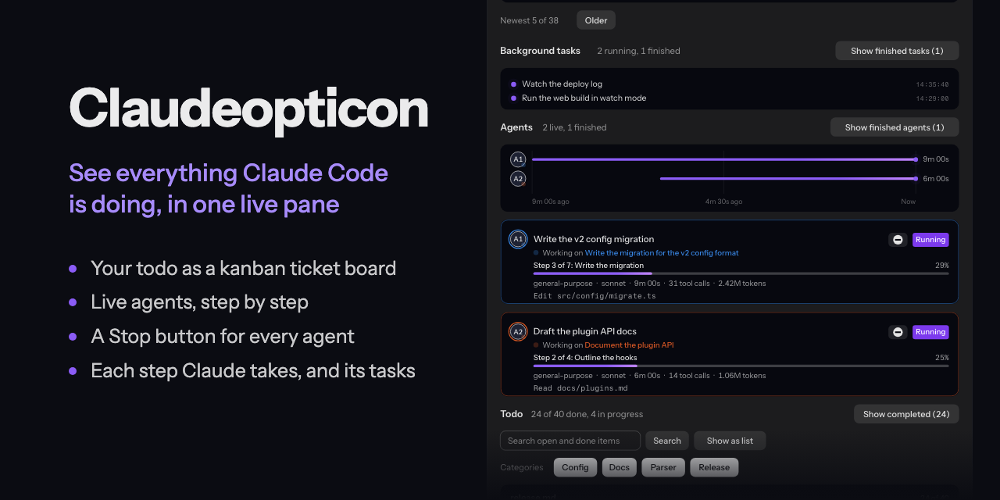
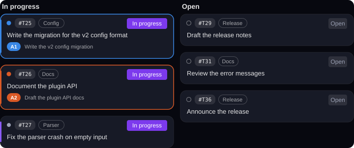

# Claudeopticon

**A ticket system for Claude Code. Plan the work, hand it to Claude, and watch it get done.**

- **Todo as interactive kanban-style tickets:** your `.claude_todo/` list as a board you can send, ask about and move.
- **Real time agent output monitoring:** what Claude and each helper agent is doing, step by step.
- **Global token burn tracking:** every token of the main conversation and all agents, as a live graph of the total since compact and the tokens per minute.

Claudeopticon is a mod for Claude Code. It adds a work pane next to your conversation which shows your todo list as a ticket board, what Claude is doing, and what its helpers (Claude Code calls them agents) are doing. You can send a ticket to Claude, ask how it is going, or move it yourself.



At its core is a ticket system that lives in your repo. Each line in `.claude_todo/` is a ticket with an ID such as `#T002A`. From the board you can send a ticket to Claude, ask for a status update, or move it between Open, Queued, In progress and done. A ticket that is done leaves the board for the archive. Claude keeps each ticket's state up to date as it works, and every helper agent is linked to the tickets it works on.

## Contents

- [Requirements](#requirements)
- [Install](#install)
- [Quick start](#quick-start)
- [The pane](#the-pane)
- [The todo format](#the-todo-format)
- [Rules for Claude](#rules-for-claude)
- [Agents and progress](#agents-and-progress)
- [Options](#options)
- [Cost and privacy](#cost-and-privacy)
- [Limits](#limits)
- [Development](#development)
- [License](#license)

## Requirements

- Claude Code 2.1.275 or later.
- The desktop app or VS Code for the card view. A terminal shows the same data as text.

## Install

Run this line in Claude Code:

```
/plugin install claudeopticon --marketplace Marceux-Croix/Claudeopticon
```

The pane opens at the start of each session. To open it again, run `/claudeopticon`. In a session that is already running, run `/reload-plugins` first.

## Quick start

1. Make a folder `.claude_todo/` at the root of your repo, and a file in it, for example `.claude_todo/TODO.md`:

   ```markdown
   - [ ] #T0001 Write the migration for the v2 config format
   - [ ] #T0002 Document the plugin API
   ```

2. Open the pane. The items show as tickets in the Open column.
3. Click `⋙` on a ticket to send it to Claude. Claude marks it `[~]`, and the ticket moves to In progress.
4. When Claude starts an agent for a ticket, the agent's card links to it and shows its progress.

## The pane

### Top card



The top card is a live graph of the last 30 minutes, with three lines:

- **Live agents** (yellow, left axis): how many helper agents run at each moment.
- **All tokens since compact** (lime green, right axis): every token that Claude and its agents used since the last compaction, when Claude Code shrinks a long conversation to free up room. A token is the unit of Claude's usage. At a compaction the line drops to zero, and a dashed line marks it. The token axis is scaled to the count after the last compaction, so the line since then fills the graph. A count from before the compaction that is too tall is cut off at the top: a zigzag marks the cut, with the true peak (for example "372M") under it.
- **Tokens per minute** (blue, right axis): the tokens used in each minute. It has its own scale, the blue column of numbers next to the green one, fitted to the highest rate in view. The two scales share the gridlines, but each line fills its own scale, so the rate stays readable when the count since compact is very large.

Each vertical axis has a title ("Live agents", "Tokens"). The top row gives the totals, "total session tokens" and how many agents have finished, followed by the key for the three lines. Each line ends in a dot with its current value. The end value is a label with a halo, placed clear of the lines where the plot has a clear place, with a leader line to its dot when it must sit far away. Lines that end at equal values share one dot, split into wedges of their colors. The token axis shows "0" at the bottom and counts up in k, M and B (thousand, million, billion). Each axis's numbers are in its line's color: yellow for live agents, green for all tokens since compact, blue for tokens per minute. The axes grow when a line would leave the graph, and shrink once every value in view is below half. The graph redraws at most every 5 seconds while numbers change, and every 30 seconds otherwise. A reload keeps the last 30 minutes. Todo progress is in the Todo section's header. The mod's version is in small type in the lower right corner, so after a reload you can see which version runs.

The mod counts every model request once, at the step that used it: the main conversation's and each agent's. It never counts a whole run at its end, so a compaction splits the tokens at the right place.

### Orchestrator: what Claude is doing



This card lists what Claude does itself, not its agents. Each line is the short description Claude already writes for an action, with its start time. A dim second line shows the detail from the action itself: the command, the file path, the search pattern, the web address, or the kind of agent started. A command that looks like it holds a password, token or key shows "(hidden)". The newest is on top. A pulsing dot means the action still runs. **Older** and **Newer** page through the history.

### Agents: what Claude's helpers are doing



Each agent gets a card, labeled A1, A2, and so on, in start order. A label never changes during a session, also after `/reload-plugins`, and long labels such as A1000 shrink to fit their circle. Each agent gets a color when it starts and keeps it. There are 16 colors, the most distinct used first. A color is used again once its agent finishes. With 16 agents live, a new agent shares a color. A card shows what the agent was asked to do, its tickets, its progress ("Step 3 of 7" with a bar), its run time, tool calls and tokens, and what it does now. A timeline above the cards shows one bar per agent.

Claude sometimes works on a ticket itself, with no helper agent. Then an **Orchestrator** card, tagged **O**, shows above the agent cards, but only while Claude works such a ticket in a turn. Between turns the card is gone. Its title is a headline Claude writes for that work, through `report_progress`; until Claude sends one, the title is the text of its first ticket ("and 2 more" when it has several). It shows the tickets Claude works on, Running, and Claude's last action. When Claude hands a ticket to a helper agent, the ticket belongs to that agent while it runs: it shows on the agent's card and with the agent's disk on the board, not the orchestrator's. A ticket counts as Claude's own when Claude moves it to in progress or names it in a progress report, or when you send it with `⋙`. It stops counting when it leaves In progress. The Orchestrator card has no Stop button and does not count in the top card.

A running agent has a **Stop** button (⊖) left of its status. Stop ends the agent at once. It gets no chance to finish its step or write a summary. Use it when an agent has gone wrong.

An agent that finished its work but was never stopped shows **Idle**, with the time it finished and its last command marked "Last:". It does not count as live, and it keeps its Stop button so you can close it.

If an agent vanishes from Claude Code's agent list without a report of how it ended, its card shows **Ended** after 15 seconds.

Finished agents are hidden. **Show finished agents** brings them back, grayed out, and **Hide finished agents** hides them again. You can name an agent by its label in chat ("how is A2 doing?"), up to A999999. The mod tells Claude which agent that is.

### Todo: the ticket board



The pane draws one board for all your todo files, with the columns **In progress**, **Queued** and **Open**. Queued (`- [>]`) holds the work slated next: tickets nobody works on yet, but that come before the rest of Open. There is no Done column: a ticket that is done leaves the board and goes to the archive. Above it, one header card has a row for each file: its name, its progress bar, and its own "done of total" count, which includes the file's closed items in the archive. If two files have the same name, the row also shows the folder in dim text. A ticket shows its number, its group, its status, and the tags of the agents working on it. The tags blink in the agent's color while it works, and the **O** tag blinks while Claude works on the ticket itself. When an agent starts on an open or queued ticket, the ticket moves to In progress by itself.

Tickets have buttons on the bottom edge:

| Button | On | What it does |
| --- | --- | --- |
| `⋙` Send to Claude | Open and queued tickets not yet sent | Sends the item to Claude as a prompt, to build it. |
| `?` Ask Claude for a status update | Every ticket, in every column | Asks Claude for a short report in the chat. It starts no new work. |
| `≡` Move to queued | Open tickets | Moves the ticket by hand. |
| `◐` Mark in progress | Open and queued tickets | Moves the ticket by hand. |
| `✓` Mark done | Open, queued and in-progress tickets | Moves the ticket by hand. The mod then archives it. |
| `↪` Move back | Queued tickets and tickets in progress | Moves the ticket back one column by hand: in progress to queued, queued to open. |

The move buttons are for work you do yourself, such as a human review. They change the checkbox in your todo file and nothing else. Claude is told at its next action, so it does not work on a ticket you closed. It is not asked to do anything.

The Todo heading says how many todo files the board pulls from ("Pulling todo from 3 files"; archives are not counted). Up to three buttons sit next to it. Each shows only when it has work to do, and disappears once it is done. You can use one, two or all three, in any order.

- **Consolidate todos** (more than one todo file): moves every ticket into one central file, `TODO.md` in the repo's root `.claude_todo/`. If that folder has no `TODO.md` but exactly one other todo file, that file is the central file. Notes move too, under a `## From <folder>/<file>` heading per file. Nothing is folded and nothing is deleted. A ticket whose `#T` ID the central file already uses gets the next ID that no file uses, references to it follow, and Claude is told the new IDs once. Archive files move into the same-named file in the central `archive/`. Each old file is emptied only after its content is confirmed in the central file. If a file changed in the meantime, it is left alone, and the pane names it. The emptied files stay on disk and in the header, marked Empty, until you delete them.
- **Delete empty todos** (an empty todo file exists): moves empty todo files to the Trash (the Recycle Bin on Windows), so you can get them back. Then it removes their `archive/` and `.claude_todo/` folders if those are empty too. It never deletes a file outright: if it cannot use the Trash, it keeps the file and says why. It never removes the central file, a file with content, or `categories.json`.
- **Delete duplicate tickets** (the central file holds identical tickets): removes tickets that are letter-for-letter identical, apart from their own ID, and keeps the first. A subtask, or a ticket with subtasks under it, is never removed. A removed ticket's ID is rewritten to the kept one wherever it is mentioned, and Claude is told once.

Each button reads a file again right before it writes it, and skips a file that changed. The buttons are off in a git worktree and when the repo root is `~/.claude`.

Other controls:

- **Show as list** shows each file as a list, and **Show as tickets** goes back to the board. **Arrange by category** groups the list.
- **Rank by recency** orders each board column newest first, by ticket ID; a ticket with no ID comes last. **Rank by group** goes back to the default order: tickets an agent works on, then by category, then in file order.
- **Show all N items** and **Show fewer** expand and shorten a long list. **Show full text** shows long items whole, and **Shorten long items** cuts them again.
- The **group buttons** show or hide each group. Haiku makes the groups: it reads your open tickets, names up to five groups, and puts each ticket in one. A ticket keeps its group, and new tickets are sorted as they appear. A ticket that fits no group, when there is no room for a new one, is tagged **Uncategorized**, as is a ticket not sorted yet.
- **Recategorize** asks Haiku to sort all open tickets into groups again, from scratch. The new groups replace the old ones only when the change is real: the number of groups changes, or at least a quarter of the open tickets would land in a different group. A rename alone does not count. Otherwise the current groups stay, and "The current categories are correct" shows next to the button for 4 seconds.
- **Show completed (N)** opens the archive file, `.claude_todo/archive/TODO.md`, in your system's default app for Markdown files. N is the number of closed tickets in the archive. The mod makes the file if it does not exist yet.
- The **search box** finds open, queued and in-progress tickets with every word you type, and says how many match. It does not search the archive: **Show completed** opens that. **Clear search** empties the box.

## The todo format

The mod reads checkbox lines in the Markdown files at the top level of `.claude_todo/`, and in `.claude_todo/archive/`.

```markdown
- [ ] #T0004 Open item
- [>] #T0007 Queued item, slated next
- [~] #T0005 Item in progress
- [x] #T0006 Done item
```

- **IDs:** each item has an ID, unique in the project: `#T` plus 4 characters, digits and capital letters, the first one a digit. They count in base 36: `#T0009`, then `#T000A`, up to `#T9ZZZ`, which gives 466,560 IDs. After that the IDs have 5 characters, from `#T10000`. Older short IDs such as `#T12` stay valid and are never renamed. A new ID always comes after the highest one in use, old or new.
- **Numbering:** an item with no ID gets the next free one from the mod, about 5 seconds after it appears. The mod also gives Claude the next three free IDs with each prompt.
- Prose, tables and headings may surround the items. Only checkbox lines count.
- **Closed items go to the archive:** when an item is checked off (`- [x]`), the mod moves it, about 5 seconds later, to the file of the same name in `.claude_todo/archive/` (`TODO.md` to `archive/TODO.md`). It makes the archive file if it is missing, and puts the item under the same heading it had. So the live file holds only open and in-progress items, and the archive is the record of finished work. Nothing is deleted. A closed item with subtasks moves only when all of its subtasks are done, and they move with it. Headings and notes stay in the live file.
- The pane shows the tickets of every `.claude_todo/` folder in the repo together, as if they were one todo. It finds the folders with git (tracked, untracked and ignored ones; at most 20) and adds the main checkout's folders from a git worktree. It never reads the global `~/.claude/.claude_todo`.
- Files of the same name in different folders are two files, each with its own header row. Each change goes back to the file the ticket came from. Two folders may use the same `#T` ID: they stay two tickets.
- `categories.json` lives in the folder nearest to the session folder. With no such folder, items are not sorted into categories.

## Rules for Claude

At the start of each conversation, the mod gives Claude short instructions, about 3,850 characters (roughly 960 tokens). The text is `RULES` in `hooks/rules.ts`. The `rules` option turns it off. Claude is told to:

- keep the items in `.claude_todo/` at the root of the repo's main checkout (a git worktree uses the main checkout's), make the folder when the repo has none, and keep each item in the folder it is in;
- never make or use the global todo folder, `~/.claude/.claude_todo/` (or `.claude_todo/` in `$CLAUDE_CONFIG_DIR`), because the board never reads it; when the repo root is that folder's parent, use the `.claude_todo/` of the project it works in;
- write each item as one checkbox line in a top-level `.md` file (`- [ ]`, `- [>]`, `- [~]`, `- [x]`) and update its box the moment the status changes;
- mark a ticket queued (`- [>]`) when it decides the ticket comes next or waits for an event, and when it stops a ticket it has not finished but still plans to do;
- give each new item one of the free IDs the mod names (`#T` and 4 digits and capital letters, or 5 characters when the 4-character IDs run out; an item with no ID gets one from the mod), and put the item's ID in the description of each agent it starts for that item, marking the item `[~]`;
- close an item (`- [x]`) in the same turn its work is done, before its final reply, never leave finished work open or in progress, and close an agent's item when the agent's work is done;
- never delete a done item and never fold done items into a summary line; the mod moves a done ticket whose subtasks are all done to the archive, and Claude never moves it back;
- when it works on tickets itself, send a headline for that work with `report_progress` (`title` and `items`), and again when the work changes;
- find or add an item before it starts any work, and do no work that has no item;
- stop work on an item you moved to open or done;
- never change the box of an item you moved. If it thinks your move was wrong, it calls the `move_ticket` tool. You get a dialog, and the box changes only if you say yes. If the item is in more than one file, the tool refuses and lists them, and Claude calls it again with `folder` set to the item's folder path.

Claude also gets reminders. When the main conversation sets a ticket from `[~]` back to `[ ]` with an Edit or Write, the mod writes `[>]` instead, because unfinished work is usually next work, and tells Claude at once. Claude drops the ticket by setting it to `[ ]` again: the mod only queues a ticket that leaves in progress. When a reply of the main conversation names an open ticket by its ID in a sentence that puts it off ("after X lands", "next", "once", "later"), the mod asks Claude at its next action to mark it queued if it is next. It names each ticket once a session and never moves a ticket on a reply. When an agent ends while its tickets are still open or in progress, the mod names them to Claude once and asks it to close each one whose work is done. At your next prompt, it names tickets Claude claimed that are still in progress, each at most once every 30 minutes. The mod never closes a ticket itself.

## Agents and progress

The mod asks each agent to report progress after each step, with a small tool it adds, `report_progress`. Most agents can use it with no setup. The exception is a custom agent whose definition file lists its tools in a `tools:` line. Add this name to that list to get its progress bar:

```
mcp__claudeopticon__report_progress
```

Without it, the agent shows no bar but still links to its tickets.

An agent links to a ticket when its description or prompt names the ticket's `#T` ID, when it names the ticket in a progress report, when its prompt quotes the ticket's text, or when Haiku, reading the agent's task once at its start, picks the ticket.

## Options

| Option | Default | What it does |
| --- | --- | --- |
| `rules` | On | Gives Claude the instructions for keeping the todo. Turn it off if you wrote your own in `CLAUDE.md`. |

Set options in the `/config` menu, under the plugin. The desktop app does not show that menu: run `/config` in an interactive `claude` terminal. Leave `rules` on unless your `CLAUDE.md` holds the same rules, because the mod's rules are what keep Claude's todo in the format the pane reads.

### Values set in the code

Other values are constants in the module that uses them. To change one, edit that file and run `/reload-plugins`. The values in seconds count clock ticks of one second (`TICK_MS`, 1000, in `hooks/register.tsx`).

| Constant | Default | Module in `hooks/` | What it sets |
| --- | --- | --- | --- |
| `SCAN_EVERY` | 3 | `register.tsx` | Seconds between todo scans |
| `RESYNC_EVERY` | 60 | `register.tsx` | Seconds between full rereads of the todo |
| `ITEMS_SHOWN` | 12 | `register.tsx` | Tickets in a list before "Show all N items" |
| `CLOCK_MS` | 5000 | `register.tsx` | Most often, in milliseconds, that the pane redraws for a token report |
| `IDLE_DRAW_MS` | 30000 | `register.tsx` | Milliseconds between graph redraws when nothing changes |
| `NOTE_MS` | 4000 | `register.tsx` | Milliseconds the Recategorize message stays up |
| `MIN_TICKET_PX` | 300 | `register.tsx` | Narrowest ticket before the board columns stack |
| `MAX_FOLDERS` | 20 | `repo-folders.ts` | Most `.claude_todo/` folders the pane finds in a repo |
| `MAX_CATEGORIES` | 5 | `categories.ts` | Most category groups |
| `SORT_MODEL` | `haiku` | `categories.ts` | The model that sorts tickets, matches agents to tickets, and recategorizes |
| `SORT_BATCH` | 60 | `categories.ts` | Tickets per sorting request |
| `SORT_BATCHES` | 5 | `categories.ts` | Sorting requests per round |
| `SORT_EVERY_MS` | 30000 | `categories.ts` | Milliseconds between sorting rounds |
| `MATCH_MAX` | 3 | `agent-match.ts` | Most tickets the model links to one agent |
| `MATCH_ITEMS` | 80 | `agent-match.ts` | Most open tickets offered to the model when it matches an agent |
| `UNLISTED_MS` | 15000 | `agent-ends.ts` | Milliseconds before an agent that left Claude Code's list shows Ended |
| `KEPT_AGENTS` | 200 | `kept-records.ts` | Agent rows kept per session |
| `KEPT_SESSIONS` | 20 | `kept-records.ts` | Sessions whose data the store keeps |
| `ORCHESTRATOR_PAGE` | 5 | `orchestrator-history.ts` | Orchestrator lines per page |
| `ORCHESTRATOR_KEPT` | 1000 | `orchestrator-history.ts` | Orchestrator history entries kept in memory |
| `ARCHIVE_AFTER_MS` | 5000 | `archive-blocks.ts` | Milliseconds an item stays checked off before it moves to the archive |
| `NUMBER_AFTER_MS` | 5000 | `numbering.ts` | Milliseconds an item stays without an ID before the mod numbers it |
| `NEXT_IDS_SHOWN` | 3 | `claude-notes.ts` | Free IDs given to Claude with each prompt |
| `NUDGE_TICKETS` | 5 | `claude-notes.ts` | Most tickets named in one reminder to close finished work |
| `NUDGE_REPEAT_MS` | 1800000 | `claude-notes.ts` | Milliseconds before the same in-progress ticket is named again |
| `LINK_MIN_CHARS` | 12 | `links.ts` | Shortest ticket quote in an agent's prompt that links the agent |
| `CLAIM_MIN_CHARS`, `CLAIM_MIN_WORDS`, `CLAIM_MIN_SHARE` | 12, 3, 0.7 | `claim-score.ts` | How closely a progress report must match a ticket's text to claim it |
| `CLAIM_CHECK_MS` | 600000 | `progress-report.ts` | Milliseconds a ticket claim stands before the next progress reply asks the agent to confirm it |
| `TITLE_MAX` | 80 | `progress-report.ts` | Longest Orchestrator headline kept, in characters |
| `DETAIL_MAX` | 300 | `tool-calls.ts` | Longest action detail kept on the Orchestrator card, in characters |
| `WINDOW_MS` | 1800000 | `series.ts` | Milliseconds of history the top graph shows |
| `SERIES_CAP` | 2000 | `series.ts` | Points kept per graph line |
| `SPACE_MS` | 60000 | `ticket-spaces.ts` | Milliseconds the space of a removed ticket stays |
| `MAX_SPACES` | 10 | `ticket-spaces.ts` | Most such spaces at once |
| `RUN_LIMIT_MS` | 20000 | `time-limit.ts` | Milliseconds the mod waits for one outside call (trash command, git, mkdir, open) or one write job before it counts it as failed |
| `STORE_LIMIT_MS` | 5000 | `time-limit.ts` | Milliseconds the mod waits for one store read or write before it counts it as failed |

## Cost and privacy

The mod uses Haiku for two small jobs:

- **Sorting tickets into groups:** once per new ticket, up to 60 per request. Sorting a large todo the first time costs a few thousand tokens. **Recategorize** sorts all open tickets again, the same way, once per press.
- **Matching a new agent to its tickets:** one request per agent.

Everything else is free or nearly free: the Orchestrator card makes no requests, the instructions to Claude are about 850 tokens per conversation, a progress report is about 40 tokens, and card token counts come from usage Claude Code already reports.

All requests go through your own Claude Code session. The mod sends nothing anywhere else.

### What the mod writes

- **Todo files.** It writes the checkbox of a ticket you move, the checkbox of a ticket you allow Claude to move, an ID into each item that has none, and the move of closed items to the archive. Every todo write goes through one function that reads the file again first and writes only if the file did not change. A file that changed is skipped. The three todo buttons change todo files only when you click them: Consolidate writes and empties them, Delete duplicate tickets edits the central file, and Delete empty todos moves empty files to the Trash.
- **`.claude_todo/categories.json`.** It remembers each ticket's group. A copy of a damaged file is kept as `categories.json.bak`, then `.bak.2` up to `.bak.10`.
- **ID claim folders.** To give two sessions in one repo different IDs, a session claims blocks of 8 ID values by making an empty entry for the block. The entries are in `claudeopticon/id-claims` inside the git common directory (`.git` of the main checkout, shared by every worktree). Only when that folder cannot be made, and the common directory is `<root>/.git`, the entries go in `<root>/.claude_work/claudeopticon-id-claims`. A claim is stale after 4 hours, and the mod deletes stale entries below the next free block at most once an hour, keeping the newest entry of each block. A block a session leaves half used leaves a gap in the numbers. Two sessions never keep the same block.
- **Nothing else on disk.** The mod never writes the global `~/.claude/.claude_todo`.

### What the store keeps

The mod keeps these keys in the engine's store, each per session ID unless noted:

| Key | Holds |
| --- | --- |
| `agents:<session id>` | The last 200 agent rows: description, a brief of at most 600 characters, model, status, times, tool calls, progress, claims |
| `agents-base:<session id>`, `agents-cut:<session id>` | How many agents came before the first kept row, and the IDs of up to 5000 rows cut from it, so labels stay fixed |
| `series:<session id>` | The graph points, at most 2000 per line, and the compaction marks |
| `tokens:<session id>` | The session token total and the count at the last compaction |
| `orchestrator:<session id>`, `orchestrator-title:<session id>` | The tickets Claude works on itself, and its headline |
| `archive-wrote:<record>` | Marks that let a retry of the archive step skip blocks already written |
| `reserved:<repo root>` | The IDs the mod named and has not yet seen in a file, for 2 hours |
| `sessions-recent`, `sessions-dropping` | The list of the last 20 sessions, and sessions waiting to be cleared |

The store keeps the last 20 sessions. A session older than that is cleared only if it has not noted itself in the last hour; a running session notes itself every 10 minutes. A session found clearable waits 20 more minutes before its keys go.

### What the mod hides

A text that looks like it holds a secret shows as "(hidden)" and is stored that way. This covers a Bash command and any other tool detail on the Orchestrator card, an agent's current command, an agent's description, the brief the mod keeps of an agent's prompt, the title Claude gives its work, and rows loaded from an older store. The rule is in `hooks/secrets.ts`. It hides a long option with a secret word in its name (`--password`, `--api-key`), the short options of listed tools (`mysql -p`), an assignment to a name with a secret word (`TOKEN=abc`, `"password": "x"`), and the same forms in PowerShell. A line that is hidden keeps the ticket IDs it names. The rule works on the text form of the line and can miss a secret that has no such form.

## Limits

- The token count starts the first time the mod sees a session.
- Every outside call (a trash command, `git`, `mkdir`, `open`) and every write job has a time limit of 20 seconds, and every store call 5 seconds. A call that runs over counts as failed and is told once. The call itself is not stopped; its late result is dropped.
- An ID block a session leaves unused is a gap in the numbers. Gaps are normal. IDs are unique, not consecutive.
- The Orchestrator history is kept in memory, so a reload clears it.
- Agent data is saved per session, so `/reload-plugins` keeps it. An agent that started while the mod was off shows its model after its next request, and its run time counts from the load.
- An agent's progress bar comes from the agent's own reports, not from a measurement. It works well for work with clear steps, such as editing a set of files or running tests. For open-ended work, such as research, debugging or review, the agent cannot know its steps in advance, so the total may grow as it goes (step 3 of 5 can become step 4 of 9), or the reports may stop. Some agents skip the reports, and a custom agent without `report_progress` in its tool list shows no bar at all.
- Ticket buttons sit over the card, so their position is approximate.
- When a ticket leaves a column or list, its space stays empty for one minute, or until a click that changes the board (a filter, a view switch, a search), so the cards below do not move while you read. On a narrow pane, a ticket you move up from Open to In progress or Queued leaves no space: the column above grows by its card instead, so the tickets below the one you pressed stay where they were.
- On the desktop app, when a card above the part you are reading grows, shrinks, appears or goes, the content you read moves by that height. The most common cause is an agent card that starts or finishes above the board. The mod cannot hold your place: the desktop pane gives a mod no way to find where a card is without scrolling to it. A fix has to come from the desktop app (scroll anchoring). Until then, **Limit UI shift** reduces it.
- With **Limit UI shift** on, the agent area keeps the height of three agent cards, with empty gray cards for the slots no agent fills plus one trailing empty card, the timeline drawn empty before the first agent, and the Orchestrator history card the height of five entries, drawn empty before the first call, so the board below them does not move while you read. A fourth agent card, and each one after it, makes the area taller and moves the board down; when those agents leave the area goes back to its held height and the board moves up. The area also grows past its held height when a card gets taller (a progress bar, a Working on line), and keeps that height for the rest of the session. This hold is off by default: press **Limit UI shift** at the right of the Orchestrator heading to turn it on for the session. The button is filled while it is on. Off, the pane draws only the cards it has, which saves screen space but moves the board as agents come and go. Pointing at the button shows what it does.
- The pane finds the `.claude_todo/` folders once, when it starts. A new `.claude_todo/` in the session's folder or a folder above it shows at once. One made elsewhere needs `/reload-plugins` (or a new session).
- **Consolidate todos**, **Delete empty todos** and **Delete duplicate tickets** are off in a repo whose root folder is the home `.claude` folder (`~/.claude`), because there the repo's root `.claude_todo/` is Claude Code's global todo folder, which the mod never writes to. They are also off in a git worktree. In every other repo the central todo is the repo's own root `.claude_todo/`.
- Delete empty todos uses the system's own trash command: `trash` or Finder on macOS, `gio trash`, `trash-put` or `kioclient5` on Linux, and PowerShell on Windows. A Linux system with none of these keeps the files. On Windows it works only on a local fixed drive whose Recycle Bin is on, because elsewhere Windows deletes the file outright; on any other drive it keeps the file. Only the macOS command has been run on a real system. The Linux and Windows commands are covered by the mod's own tests only.
- The mod reads a todo file only through one read function and writes it only through one write function. `check-reads.ts` and `check-writes.ts` (see Development) fail on any read or write that goes around them. A read that fails is never taken for an empty file.
- The files in the known folders stay live: new items, edits, checkbox changes, new files and archived files show within a few seconds, with no restart.

[How it works](docs/how-it-works.md) explains the hooks, the linking and the drawing.

## Development

Load the repo from its folder, run the four gates, and see [CONTRIBUTING.md](CONTRIBUTING.md). The gates run by hand. There is no CI. The two scripts run on plain Node 22.18 or later, with no `npx` and no downloads.

```bash
claude --plugin-dir .
claude plugin test .
claude plugin validate .
node --import ./scripts/ts-resolve.mjs scripts/check-reads.ts
node --import ./scripts/ts-resolve.mjs scripts/check-writes.ts
```

The cards follow the [Stage UI](https://github.com/Marceux-Croix/Stage-UI) design system.

## License

[MIT](LICENSE)
